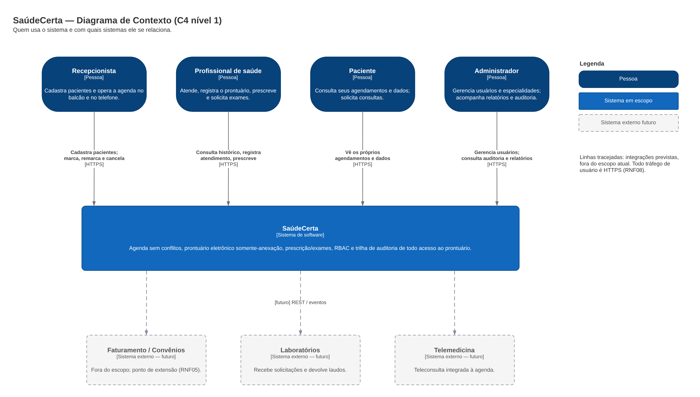
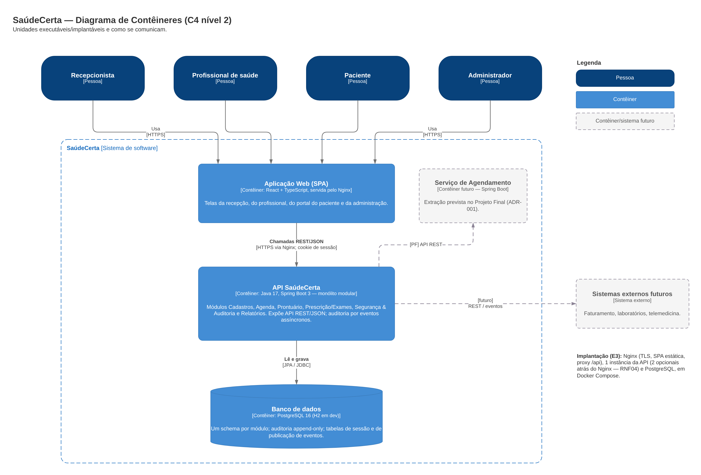
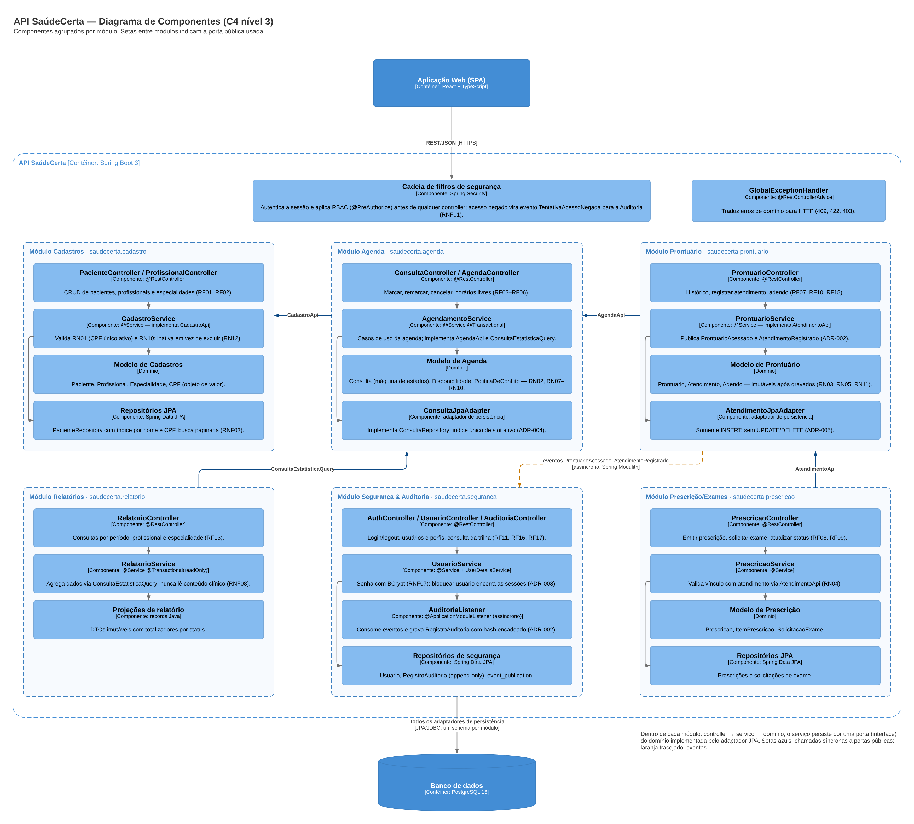
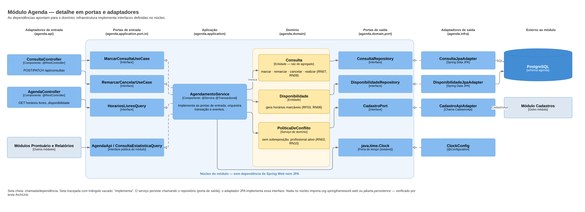

# 1. Diagramas C4

O modelo C4 (Simon Brown) descreve a arquitetura em níveis de zoom. Usamos três: **Contexto** (o sistema no mundo), **Contêiner** (as unidades que rodam e se comunicam) e **Componente** (a estrutura interna da API). Fontes editáveis: [`diagramas/`](diagramas/).

> Notação: azul-escuro = pessoa · azul = sistema/contêiner em escopo · azul-claro = componente · cinza tracejado = elemento futuro, fora do escopo atual. Cada relação tem verbo e tecnologia.

---

## 1.1 Nível 1 — Contexto



**Fonte:** `diagramas/c4-contexto.drawio`

| Elemento | Tipo | Papel | Requisitos |
|---|---|---|---|
| Recepcionista | Pessoa | Cadastra pacientes; marca, remarca e cancela consultas | RF01, RF04–RF06, RNF06 |
| Profissional de saúde | Pessoa | Consulta histórico, registra atendimento, prescreve, solicita exames | RF07–RF10, RF18 |
| Paciente | Pessoa | Vê os próprios agendamentos e dados; solicita consulta | RF14, RF15, RN06 |
| Administrador | Pessoa | Gerencia usuários e especialidades; consulta auditoria e relatórios | RF13, RF16, RF17 |
| SaúdeCerta | Sistema | Sistema em escopo | — |
| Faturamento/Convênios, Laboratórios, Telemedicina | Sistemas externos **futuros** | Fora do escopo; aparecem porque a arquitetura precisa recebê-los sem alterar o núcleo | RNF05, RNF10 |

**Decisões visíveis neste nível**

- Não há nenhuma integração externa obrigatória no escopo atual. A única fronteira de confiança é entre os usuários e o sistema, e todo tráfego nela é HTTPS (RNF08).
- O Encarregado de dados (DPO) e os órgãos reguladores são stakeholders (E1, 3.1), mas não atores: não usam o sistema. O que eles recebem são relatórios da trilha de auditoria gerados pelo administrador.

---

## 1.2 Nível 2 — Contêiner



**Fonte:** `diagramas/c4-conteiner.drawio`

| Contêiner | Tecnologia | Responsabilidade | Decisão |
|---|---|---|---|
| **Aplicação Web (SPA)** | React + TypeScript, arquivos estáticos servidos pelo Nginx | Telas dos quatro perfis. Não guarda dado clínico no navegador, só em memória enquanto a tela está aberta. | Separar UI da API permite que o Paciente e a Recepção usem a mesma API REST que o protótipo da E3 testa via Postman |
| **API SaúdeCerta** | Java 17, Spring Boot 3.x, Spring Web, Data JPA, Security, Modulith | Todos os casos de uso, regras de negócio, segurança e auditoria. Uma única unidade de implantação, internamente dividida em seis módulos. | [ADR-001](adr/ADR-001-monolito-modular-hexagonal.md) |
| **Banco de dados** | PostgreSQL 16 (H2 em desenvolvimento) | Persistência de todos os módulos, um schema por módulo; tabela de auditoria append-only; `SPRING_SESSION` e `event_publication`. | [ADR-006](adr/ADR-006-estrategia-persistencia.md), [ADR-002](adr/ADR-002-auditoria-assincrona-eventos.md), [ADR-003](adr/ADR-003-autenticacao-sessao-rbac.md) |
| Serviço de Agendamento *(futuro)* | Spring Boot | Módulo Agenda extraído no Projeto Final, com API REST própria | ADR-001 (caminho de evolução) |

**Por que não há broker de mensagens (RabbitMQ/Kafka)?** Os eventos de auditoria circulam dentro do mesmo processo e são persistidos na própria base pelo *Event Publication Registry* (ADR-002). Um broker acrescentaria um contêiner para operar, monitorar e manter disponível, sem resolver nenhum driver que a solução atual não resolva. Ele passa a fazer sentido quando o Serviço de Agendamento for extraído e precisar publicar eventos para fora do processo.

### Visão de implantação (resumo)

```
            Internet / rede da clínica
                       │ HTTPS (TLS 1.2+)
               ┌───────▼────────┐
               │  Nginx         │  serve a SPA, termina TLS, proxy /api → API
               └───────┬────────┘
                       │ HTTP interno
         ┌─────────────▼──────────────┐
         │ API SaúdeCerta (1 instância; │  healthcheck /actuator/health
         │ 2ª opcional p/ RNF04)        │  restart: always
         └─────────────┬──────────────┘
                       │ JDBC
               ┌───────▼────────┐
               │ PostgreSQL 16   │  backup diário + WAL
               └────────────────┘
```

Para a E3, tudo sobe com `docker compose up`. Como a sessão fica no banco (ADR-003), uma segunda instância da API pode ser colocada atrás do Nginx sem *sticky session*.

---

## 1.3 Nível 3 — Componente

### 1.3.1 Componentes da API, por módulo



**Fonte:** `diagramas/c4-componente.drawio`, página 1

Cada módulo segue a mesma fatia interna: `api` (controller) → `application` (serviço/caso de uso) → `domain` (entidades, regras e portas) ← `infra` (adaptadores). Os módulos só conversam por **portas públicas** (interfaces no pacote raiz do módulo) ou por **eventos**:

| De → Para | Mecanismo | Uso | Por que nesse sentido |
|---|---|---|---|
| Agenda → Cadastros | `CadastroApi` (síncrono) | Verificar se o paciente e o profissional existem e estão ativos ao marcar (RN10) | A Agenda depende de dados cadastrais, nunca o contrário |
| Prontuário → Agenda | `AgendaApi` (síncrono, mesma transação) | Ler a consulta (RN03) e marcá-la REALIZADA ao registrar o atendimento (RN09) | Precisa ser atômico com o registro do atendimento |
| Prescrição → Prontuário | `AtendimentoApi` (síncrono) | Validar que o atendimento existe e pertence ao profissional (RN04) | — |
| Relatórios → Agenda | `ConsultaEstatisticaQuery` (somente leitura) | Totais por período, profissional e especialidade (RF13) | Relatórios não leem tabelas de outro módulo diretamente |
| Prontuário → Auditoria | Eventos `ProntuarioAcessado`, `AtendimentoRegistrado` (assíncrono) | Trilha de auditoria (RF12, RNF02) | Prontuário não conhece a Auditoria: só publica o fato |
| Segurança → Auditoria | Evento `TentativaAcessoNegada` | Registrar tentativas bloqueadas (RNF01) | Mesmo mecanismo para leitura, escrita e negação |

O grafo de dependências entre módulos não tem ciclos: Cadastros ← Agenda ← Prontuário ← Prescrição, com Relatórios → Agenda e Auditoria apenas consumindo eventos. Isso é verificado pelo teste `ApplicationModules.of(SaudeCertaApplication.class).verify()` (ADR-001).

**Componentes transversais**

| Componente | Responsabilidade |
|---|---|
| Cadeia de filtros de segurança (Spring Security) | Autentica a sessão; `@PreAuthorize` nos casos de uso aplica RBAC; o `AccessDeniedHandler` publica `TentativaAcessoNegada` |
| `GlobalExceptionHandler` (`@RestControllerAdvice`) | Traduz exceções de domínio em respostas HTTP padronizadas (RFC 9457 *Problem Details*): `ConflitoDeHorarioException` → 409, `RegraDeNegocioException` → 422, `AccessDeniedException` → 403 |
| Configuração `shared` | `Clock`, configuração de JSON, OpenAPI (springdoc) para o RNF10 |

### 1.3.2 Detalhe do módulo Agenda (portas e adaptadores)



**Fonte:** `diagramas/c4-componente.drawio`, página 2

O módulo Agenda foi detalhado porque concentra a regra mais sensível a concorrência (RN02) e é o candidato à extração no Projeto Final. O desenho mostra que:

1. **Controllers** só conhecem as *portas de entrada* (interfaces de caso de uso), e não o serviço concreto.
2. **`AgendamentoService`** implementa as portas de entrada, abre a transação e delega as decisões ao domínio.
3. **O domínio** (`Consulta`, `Disponibilidade`, `PoliticaDeConflito`) não importa nada de Spring Web nem de JPA. As regras são testáveis com JUnit puro em milissegundos (RNF09).
4. **As portas de saída** (`ConsultaRepository`, `CadastroPort`, `Clock`) são interfaces do domínio, e os **adaptadores** em `infra` as implementam. É a inversão de dependência que torna a extração do serviço viável: no PF, `CadastroApiAdapter` passa a ser um cliente HTTP, sem que nada no núcleo mude.
5. O tempo entra como porta (`java.time.Clock`), para que RN03 (“data já ocorreu ou é hoje”) e RN08 (“data futura”) possam ser testadas com relógio fixo.
