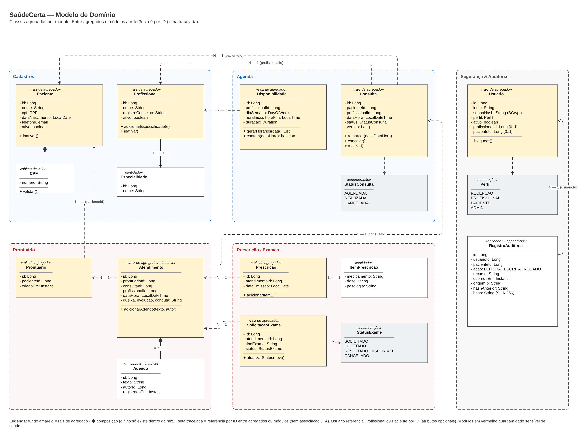

# 2. Camadas, componentes e modelo de domínio

## 2.1 Camadas

O SaúdeCerta é organizado em **duas dimensões**. Na vertical, o código é fatiado por **módulo de negócio** (Cadastros, Agenda, Prontuário, Prescrição/Exames, Segurança & Auditoria, Relatórios). Dentro de cada módulo, as **camadas** seguem a arquitetura hexagonal: o domínio fica no centro e não depende de nada técnico.

| Camada (pacote) | Responsabilidade | Artefatos Spring / Java | Pode depender de | Não pode |
|---|---|---|---|---|
| **Apresentação** (`api`) | Expor endpoints REST; converter HTTP ↔ DTO; validar formato da entrada | `@RestController`, `record` DTOs, Bean Validation (`@Valid`, `@NotBlank`, `@CPF`) | `application` (portas de entrada) | Acessar repositórios; conter regra de negócio; expor entidades |
| **Aplicação** (`application`) | Orquestrar casos de uso; definir transação; aplicar autorização; publicar eventos | `@Service`, `@Transactional`, `@PreAuthorize`, `ApplicationEventPublisher` | `domain`; portas públicas de outros módulos | Conhecer HTTP (`HttpServletRequest`), SQL ou JPA |
| **Domínio** (`domain`) | Entidades, objetos de valor, regras de negócio (RN01–RN12), invariantes, portas de saída | Classes Java puras, `enum`, exceções de domínio, interfaces de repositório | Somente `java.*` e o próprio domínio | Importar `org.springframework.*`; em Agenda, Prontuário e Segurança, também `jakarta.persistence` (ADR-006) |
| **Infraestrutura** (`infra`) | Implementar as portas de saída: persistência, relógio, chamadas a outros módulos | `@Repository`, Spring Data JPA, entidades JPA, `@Configuration` | `domain` | Ser chamada diretamente por `api` |
| **Transversal** (`shared`, `seguranca`) | Segurança, tratamento de erros, auditoria, configuração | Spring Security, `@RestControllerAdvice`, Actuator, springdoc-openapi | — | Ter regra de negócio de outro módulo |

### Regras de dependência

1. **Toda dependência aponta para o domínio.** `infra` implementa interfaces de `domain`; `domain` não conhece `infra`.
2. **Um módulo só enxerga a interface pública do outro.** Classes em `agenda.domain`, `agenda.infra` etc. são internas; o que outros módulos podem usar fica no pacote raiz (`agenda.AgendaApi`).
3. **Sem ciclos entre módulos.**
4. **Entidades não atravessam a API.** O controller recebe e devolve `record`s; o mapeamento é explícito.

As regras são **verificadas no build** (não dependem de disciplina):

```java
// src/test/java/br/edu/ifpa/saudecerta/ArquiteturaTest.java
class ArquiteturaTest {

    @Test
    void modulosRespeitamFronteiras() {
        // Spring Modulith: falha se um módulo usar classe interna de outro ou se houver ciclo
        ApplicationModules.of(SaudeCertaApplication.class).verify();
    }

    @ArchTest
    static final ArchRule dominioIsolado = noClasses()
        .that().resideInAPackage("..domain..")
        .should().dependOnClassesThat()
        .resideInAnyPackage("org.springframework.web..", "jakarta.servlet..", "..infra..", "..api..");

    @ArchTest
    static final ArchRule controllersSoUsamAplicacao = noClasses()
        .that().resideInAPackage("..api..")
        .should().dependOnClassesThat().resideInAPackage("..infra..");
}
```

### Estrutura de pacotes

```
br.edu.ifpa.saudecerta
├── SaudeCertaApplication.java
├── cadastro/
│   ├── CadastroApi.java                 ← porta pública do módulo
│   ├── api/          PacienteController, ProfissionalController, dto/
│   ├── application/  CadastroService
│   ├── domain/       Paciente, Profissional, Especialidade, Cpf, PacienteRepository (porta)
│   └── infra/        PacienteJpaRepository, ...
├── agenda/
│   ├── AgendaApi.java, ConsultaEstatisticaQuery.java
│   ├── api/          ConsultaController, AgendaController, dto/
│   ├── application/  AgendamentoService, port/in/ (MarcarConsultaUseCase, ...)
│   ├── domain/       Consulta, StatusConsulta, Disponibilidade, PoliticaDeConflito,
│   │                 ConsultaRepository, CadastroPort, ConflitoDeHorarioException
│   └── infra/        ConsultaJpaAdapter, CadastroApiAdapter
├── prontuario/
│   ├── AtendimentoApi.java, ProntuarioAcessado.java, AtendimentoRegistrado.java  ← eventos públicos
│   ├── api/ application/ domain/ infra/
├── prescricao/       api/ application/ domain/ infra/
├── relatorio/        api/ application/
├── seguranca/
│   ├── TentativaAcessoNegada.java
│   ├── api/          AuthController, UsuarioController, AuditoriaController
│   ├── application/  UsuarioService, AuditoriaListener
│   ├── domain/       Usuario, Perfil, RegistroAuditoria, CadeiaDeHash
│   └── infra/        SecurityConfig, repositórios
└── shared/           GlobalExceptionHandler, ClockConfig, OpenApiConfig
```

---

## 2.2 Catálogo de componentes por módulo

| Módulo | Componentes principais | Porta pública oferecida | Depende de | Dado |
|---|---|---|---|---|
| **Cadastros** | `PacienteController`, `ProfissionalController`, `CadastroService`, `Paciente`, `Profissional`, `Especialidade`, `Cpf` | `CadastroApi` (buscar paciente/profissional ativo) | — | Pessoal |
| **Agenda** | `ConsultaController`, `AgendaController`, `AgendamentoService`, `Consulta`, `Disponibilidade`, `PoliticaDeConflito`, `ConsultaJpaAdapter` | `AgendaApi` (obter e realizar consulta), `ConsultaEstatisticaQuery` | Cadastros | Operacional |
| **Prontuário** | `ProntuarioController`, `ProntuarioService`, `Prontuario`, `Atendimento`, `Adendo`, `AtendimentoJpaAdapter` | `AtendimentoApi`; eventos `ProntuarioAcessado`, `AtendimentoRegistrado` | Agenda | **Sensível** |
| **Prescrição/Exames** | `PrescricaoController`, `PrescricaoService`, `Prescricao`, `ItemPrescricao`, `SolicitacaoExame` | — | Prontuário | **Sensível** |
| **Segurança & Auditoria** | `AuthController`, `UsuarioController`, `AuditoriaController`, `UsuarioService`, `AuditoriaListener`, `Usuario`, `RegistroAuditoria`, `SecurityConfig` | evento `TentativaAcessoNegada` | eventos de Prontuário | Credenciais, logs |
| **Relatórios** | `RelatorioController`, `RelatorioService`, projeções (`record`) | — | Agenda | Agregado |

### API REST (núcleo)

| Método | Rota | Caso de uso | Perfil | Requisitos |
|---|---|---|---|---|
| `POST` | `/api/pacientes` | Cadastrar paciente | RECEPCAO, ADMIN | RF01, RN01 |
| `GET` | `/api/pacientes?nome=&page=&size=` | Buscar paciente (paginado) | RECEPCAO, PROFISSIONAL, ADMIN | RF01, RNF03 |
| `PATCH` | `/api/pacientes/{id}/inativar` | Inativar cadastro | ADMIN | RN12 |
| `POST` | `/api/profissionais` | Cadastrar profissional | ADMIN | RF02 |
| `PUT` | `/api/profissionais/{id}/disponibilidade` | Definir disponibilidade | PROFISSIONAL (próprio), ADMIN | RF03 |
| `GET` | `/api/profissionais/{id}/horarios-livres?data=` | Horários livres | todos autenticados | RF03, RNF06 |
| `POST` | `/api/consultas` | Marcar consulta | RECEPCAO, PACIENTE (próprio) | RF04, RF06, RF15 |
| `PATCH` | `/api/consultas/{id}` | Remarcar (`{"dataHora":...}`) ou cancelar (`{"status":"CANCELADA"}`) | RECEPCAO, PACIENTE (próprio) | RF05, RN07, RN09 |
| `GET` | `/api/pacientes/{id}/consultas` | Consultas do paciente | RECEPCAO, PACIENTE (próprio) | RF14 |
| `GET` | `/api/pacientes/{id}/prontuario` | Histórico — **gera auditoria** | PROFISSIONAL, PACIENTE (próprio) | RF10, RF12 |
| `POST` | `/api/consultas/{id}/atendimento` | Registrar atendimento | PROFISSIONAL (da consulta) | RF07, RN03, RN05 |
| `POST` | `/api/atendimentos/{id}/adendos` | Adendo | PROFISSIONAL | RF18, RN11 |
| `POST` | `/api/atendimentos/{id}/prescricoes` | Emitir prescrição | PROFISSIONAL | RF08, RN04 |
| `POST` | `/api/atendimentos/{id}/exames` | Solicitar exame | PROFISSIONAL | RF09, RN04 |
| `POST` | `/api/auth/login` · `/logout` | Autenticar | público / autenticado | RF11 |
| `POST` · `PATCH` | `/api/usuarios`, `/api/usuarios/{id}/bloquear` | Gerenciar usuários | ADMIN | RF16 |
| `GET` | `/api/auditoria?pacienteId=&usuarioId=&de=&ate=` | Consultar trilha | ADMIN | RF17 |
| `GET` | `/api/relatorios/consultas?de=&ate=&agrupar=profissional` | Relatórios | ADMIN | RF13 |

Não existe `DELETE` nem `PUT` para atendimento, prescrição ou adendo (ADR-005).

**Exemplo de conflito (RF06)**

```http
POST /api/consultas
{ "pacienteId": 1024, "profissionalId": 17, "dataHora": "2026-11-17T19:30:00" }

HTTP/1.1 409 Conflict
Content-Type: application/problem+json
{
  "type": "https://saudecerta/erros/conflito-de-horario",
  "title": "Horário indisponível",
  "status": 409,
  "detail": "O profissional 17 já tem consulta AGENDADA em 17/11/2026 19:30.",
  "horariosSugeridos": ["2026-11-17T20:00:00", "2026-11-17T20:30:00"]
}
```

O campo `horariosSugeridos` atende à persona Márcia (RNF06): o conflito aparece na mesma tela, já com alternativas, sem um passo extra de busca.

---

## 2.3 Modelo de domínio



**Fonte:** `diagramas/modelo-dominio.drawio`

### Agregados

Um **agregado** é um conjunto de objetos que muda junto e tem uma raiz responsável por suas invariantes. Ele é a unidade de transação e de consistência. Entre agregados, a referência é por ID, nunca por associação de objeto.

| Agregado (raiz) | Contém | Invariantes que protege | Por que essa fronteira |
|---|---|---|---|
| `Paciente` | `Cpf` (VO) | CPF válido (RN01, parte local) | Cadastro muda independentemente da agenda |
| `Profissional` | vínculo com `Especialidade` | ≥ 1 especialidade (RF02) | — |
| `Disponibilidade` | — | horaFim > horaInicio; duração divide a faixa (RF03) | Muda raramente e é lida a cada marcação |
| `Consulta` | `StatusConsulta` | Transições válidas (RN07, RN09); data futura e dentro da disponibilidade ao marcar (RN08) | Unidade de concorrência da agenda (ADR-004) |
| `Prontuario` | — | um por paciente | Só ancora o histórico |
| `Atendimento` | `Adendo` (0..*) | Imutável após salvo (RN05); adendo só por profissional; data da consulta ≤ hoje (RN03) | Separado do `Prontuario` para que registrar um atendimento não exija carregar todo o histórico (DA4) |
| `Prescricao` | `ItemPrescricao` (1..*) | ≥ 1 item; vínculo com atendimento (RN04) | — |
| `SolicitacaoExame` | `StatusExame` | Transições de status válidas | Tem ciclo de vida próprio (coleta, resultado) |
| `Usuario` | `Perfil` | login único; bloqueado não autentica (RF16) | — |
| `RegistroAuditoria` | — | Imutável; `hash = SHA-256(hashAnterior + conteúdo)` | Append-only, encadeado (ADR-002) |

**Por que referência por ID?** `Consulta` guarda `pacienteId`, e não `Paciente`. Assim (1) o módulo Agenda não carrega o cadastro inteiro a cada consulta; (2) não há `@ManyToOne` atravessando schemas de módulos diferentes; (3) quando a Agenda virar serviço no PF, o modelo continua igual, porque a referência já era um identificador.

### Onde cada regra de negócio é garantida

| Regra | Onde | Mecanismo de reforço |
|---|---|---|
| RN01 CPF único ativo | `CadastroService` + `Cpf` | Índice único `(cpf) WHERE ativo` → coluna `cpf_ativo` (mesma técnica do ADR-004) |
| RN02 sem consultas sobrepostas | `PoliticaDeConflito` | Índice único de slot ativo — [ADR-004](adr/ADR-004-concorrencia-marcacao.md) |
| RN03 atendimento só para consulta de hoje ou passada | `Atendimento.registrar(consulta, clock)` | Teste com `Clock.fixed` |
| RN04 prescrição/exame vinculados a atendimento | Construtor de `Prescricao` exige `atendimentoId`; `PrescricaoService` valida via `AtendimentoApi` | Coluna `atendimento_id NOT NULL` (sem FK entre schemas — ADR-006) |
| RN05 prontuário somente-anexação | `Atendimento` sem *setters*; sem endpoint de alteração | `REVOKE UPDATE, DELETE` — [ADR-005](adr/ADR-005-prontuario-somente-anexacao.md) |
| RN06 paciente só vê o próprio; recepção sem conteúdo clínico | `@PreAuthorize` + verificação de titularidade | Teste de segurança por perfil — [ADR-003](adr/ADR-003-autenticacao-sessao-rbac.md) |
| RN07 cancelar só AGENDADA | `Consulta.cancelar()` | Teste unitário |
| RN08 marcar dentro da disponibilidade e no futuro | `Disponibilidade.contem()` + `Consulta.marcar()` | Teste unitário |
| RN09 estados finais | `Consulta` (máquina de estados) | Teste parametrizado de todas as transições |
| RN10 profissional inativo não recebe marcação | `PoliticaDeConflito` via `CadastroPort` | Teste unitário com *stub* da porta |
| RN11 correção por adendo | `Atendimento.adicionarAdendo()` | — |
| RN12 retenção de 20 anos; inativar em vez de excluir | Ausência de exclusão física; `Paciente.inativar()` | Política de backup documentada |

### Exemplo: domínio rico em vez de anêmico

As regras ficam na entidade, e não espalhadas pelo service (erro comum nº 1 do guia):

```java
public class Consulta {
    private final Long id;
    private final Long pacienteId;
    private final Long profissionalId;
    private LocalDateTime dataHora;
    private StatusConsulta status;

    public static Consulta marcar(Long pacienteId, Long profissionalId, LocalDateTime dataHora,
                                  Disponibilidade disp, Clock clock) {
        if (!dataHora.isAfter(LocalDateTime.now(clock)))
            throw new RegraDeNegocioException("RN08", "A consulta deve ser marcada para data futura.");
        if (!disp.contem(dataHora))
            throw new RegraDeNegocioException("RN08", "Horário fora da disponibilidade do profissional.");
        return new Consulta(null, pacienteId, profissionalId, dataHora, StatusConsulta.AGENDADA);
    }

    public void remarcar(LocalDateTime novaDataHora, Disponibilidade disp, Clock clock) {
        exigirStatus(StatusConsulta.AGENDADA, "RN09");
        // mesmas validações de marcar(...)
        this.dataHora = novaDataHora;
    }

    public void cancelar() {
        exigirStatus(StatusConsulta.AGENDADA, "RN07");
        this.status = StatusConsulta.CANCELADA;
    }

    public void realizar(Clock clock) {
        exigirStatus(StatusConsulta.AGENDADA, "RN09");
        if (dataHora.toLocalDate().isAfter(LocalDate.now(clock)))
            throw new RegraDeNegocioException("RN03", "Consulta ainda não ocorreu.");
        this.status = StatusConsulta.REALIZADA;
    }

    private void exigirStatus(StatusConsulta esperado, String regra) {
        if (status != esperado)
            throw new RegraDeNegocioException(regra, "Operação inválida para consulta " + status + ".");
    }
}
```

O `AgendamentoService` fica fino: carrega, chama o método de domínio, salva e publica evento.
