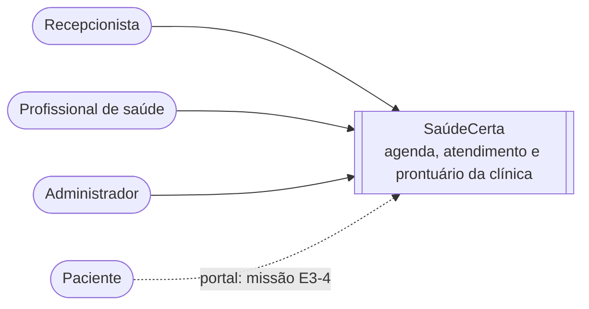
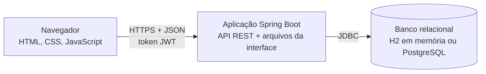
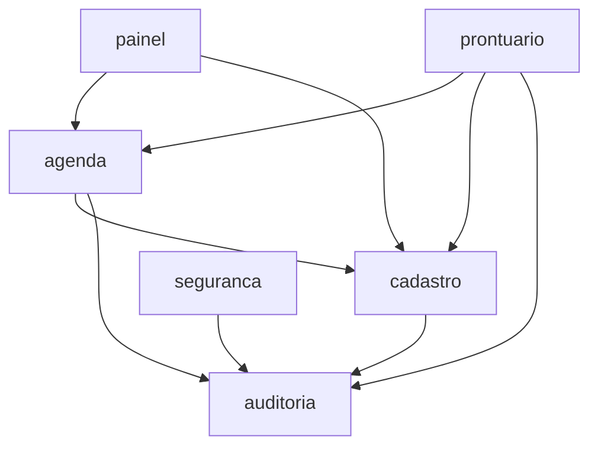
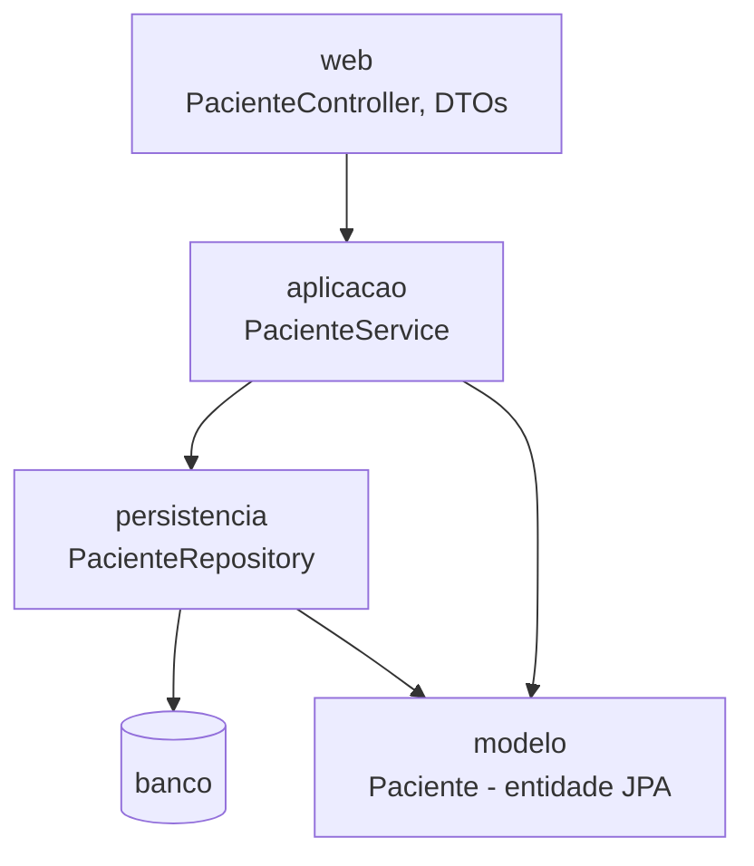
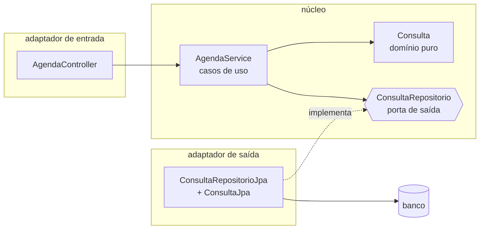

# Arquitetura do SaúdeCerta

Os diagramas usam Mermaid: o GitHub, o IntelliJ e o VS Code (com extensão) os desenham a partir do texto.

## 1. Contexto (C4 nível 1)

Não há sistemas externos nesta versão. Faturamento, laboratórios e telemedicina estão fora do escopo e são pontos de extensão.

## 2. Contêineres (C4 nível 2)

Um único processo serve a interface e a API. A interface é um cliente da API como qualquer outro: tudo o que ela faz pode ser feito pelo Swagger ou pelo arquivo `docs/api.http`.

## 3. Componentes: os módulos (C4 nível 3)

Regras do **monólito modular** (ADR 0001):

- cada pacote de primeiro nível é um módulo;
- um módulo só usa o pacote `api` do outro (`CadastroFachada`, `AgendaFachada`, `Auditoria`, `UsuarioLogado`);
- não há chave estrangeira JPA entre módulos — a agenda guarda `pacienteId`, não um `Paciente`;
- não há dependência circular.

Essas regras existem para que um módulo possa virar serviço sem reescrever os outros (missão PF-1).

## 4. Dentro de um módulo: dois estilos

### Camadas (módulo `cadastro`)

A entidade JPA é o próprio modelo. Simples e suficiente para cadastro.

### Hexagonal (módulos `agenda` e `prontuario`)

As setas de dependência apontam para dentro. `Consulta` não importa Spring nem JPA, por isso seus testes rodam em milissegundos. O custo é o mapeamento `Consulta ⇄ ConsultaJpa`. A comparação entre os dois estilos está na ADR 0002.

## 5. Transversais

| Preocupação | Solução | Onde |
|---|---|---|
| Autenticação | token JWT assinado (HS256), sem sessão no servidor | `seguranca`, ADR 0005 |
| Autorização | perfis (RBAC) por rota + regra de "profissional responsável" no domínio | `SecurityConfig`, `Atendimento`, ADR 0004 |
| Auditoria | registro síncrono em transação própria | `auditoria`, ADR 0003 |
| Erros | Problem Details (RFC 9457) em um único ponto | `TratadorDeErros` |
| Tempo | `Clock` injetado | `RelogioConfig` |
| Observação das camadas | AOP + filtro HTTP | `compartilhado.raiox`, `docs/raio-x.md` |

## 6. Como a arquitetura é protegida

`ArquiteturaTest` (ArchUnit) transforma as regras acima em testes. Importar a classe errada quebra o build e a mensagem diz qual regra e em qual linha.
